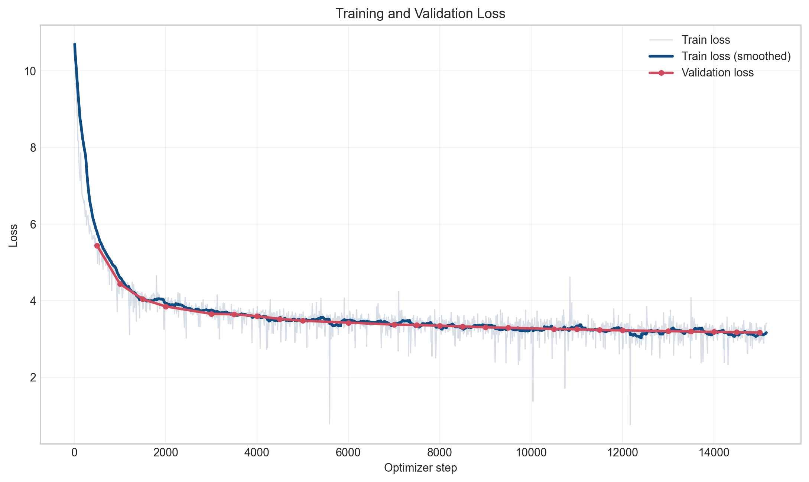
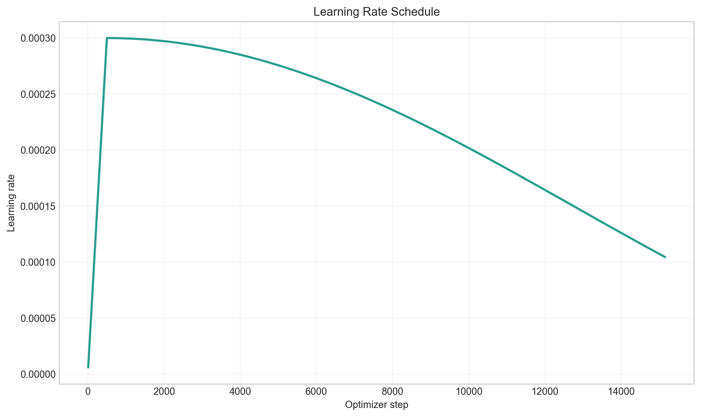
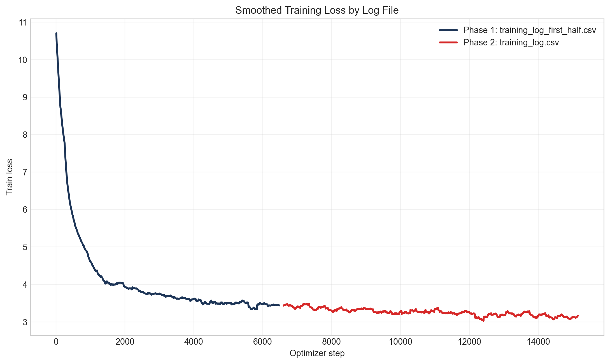
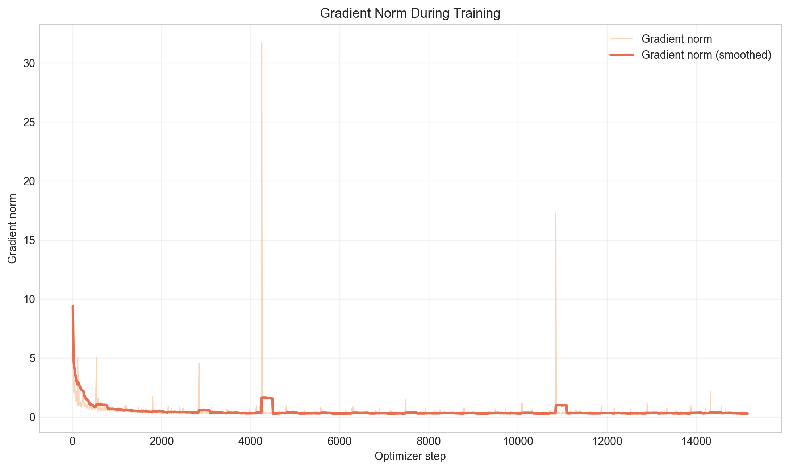
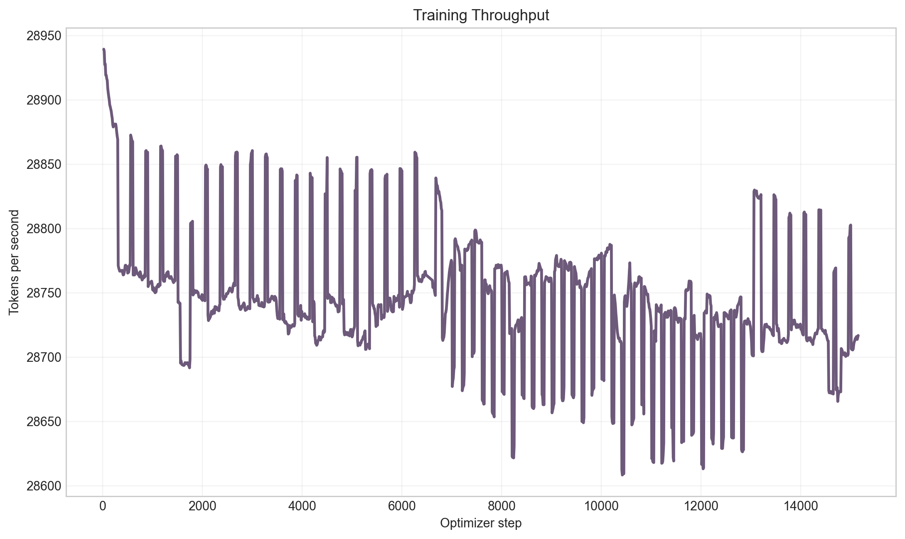
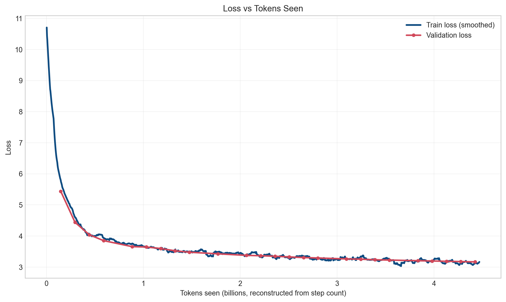

# TinyLLM From Scratch

I wanted to understand how a modern LLM actually works, so we built one. TinyLLM is a 373M-parameter, Llama-style language model that we pretrained from random weights on a single A100. Everything is plain PyTorch: the data pipeline, the transformer, the training loop and the sampler. There are no pretrained weights and no Hugging Face Transformers.

---

## Results at a glance

- About 4.4B tokens seen over roughly 5 days on one A100 80GB (Colab Pro)
- Loss went from about 10.7 at initialization to below 3.13 (train) and about 3.2 (validation) by step 15,000
- Train and validation loss stay close the whole way, so there's no sign of overfitting at this scale
- We stopped at 15,000 of the planned 25,000 steps because we ran out of compute time



A quick note on perplexity: a loss of 3.13 works out to a perplexity of about 23. That number is only meaningful on our own SlimPajama validation split with the `cl100k_base` tokenizer. It can't be compared directly to models trained on other data or with other tokenizers.

---

## What it writes

This is unedited output from the final checkpoint.

**Prompt:** `Once upon a time in a small village`

> Once upon a time in a small village called Bala, the father and son had to leave the village. There, they were attacked by a wild beast. A man, from the village, came to the village and he found himself captured. The beast attacked the village, killed him and then set him on fire. The villagers continued to fight for their lives until he was killed. The village was destroyed. There were also several local tribesmen, who were massacred and burned. In the following year, a large group of tribesmen arrived in Bala to fight for their lives and for the people. They were the only people to survive the attack on the village. [...] There were also the tribesmen of the village who lived with them and they were the only people to survive the attack on the village.

**Prompt:** `Machine learning is a subset of artificial intelligence that`

> Machine learning is a subset of artificial intelligence that can be used to train human learning models for various tasks. The aim of the project is to investigate the potential of artificial intelligence for training artificial neural networks using two-dimensional (2D) data sets with three-dimensional (3D) data. Specifically, the aim of this study was to develop a novel method for the generation of a training set of the two-dimensional (2D) data with four different classes [...]

The model has clearly picked up genre and style. The first sample reads like a story and the second like a paper abstract. It also clearly hasn't learned to keep facts straight: it can't decide whether its data is 2D or 3D, and it falls into loops. That's about what you'd expect from a model this size at this point in training.

---

## Model

The architecture follows the Llama recipe:

| Component           | Choice                                           |
| ------------------- | ------------------------------------------------ |
| Parameters          | 373M                                             |
| Layers              | 24                                               |
| Model dimension     | 1,024                                            |
| Attention           | Grouped Query Attention, 16 Q heads / 4 KV heads |
| Feed-forward        | SwiGLU, d_ff = 2,816                             |
| Positional encoding | RoPE, θ = 500,000                                |
| Normalization       | RMSNorm, pre-norm                                |
| Context length      | 2,048 tokens                                     |
| Vocabulary          | 100,277 (`cl100k_base`)                          |
| Weight tying        | Token embedding and LM head share weights        |

A few details that don't fit in a table:

- Attention uses PyTorch's `scaled_dot_product_attention`, so it gets fused FlashAttention-style kernels on the A100.
- Output projections are initialized with std `0.02 / sqrt(2 * n_layers)`, following GPT-2. This keeps the residual stream from blowing up early in training.
- With GQA, only 4 KV heads are kept per layer, so the KV cache is 4× smaller than with standard multi-head attention.

The model code lives in [model/](model/).

---

## Data

We trained on [SlimPajama-6B](https://huggingface.co/datasets/DKYoon/SlimPajama-6B), a cleaned and deduplicated slice of RedPajama. It's a mix of web pages, books, GitHub code, arXiv, Wikipedia and StackExchange. We downloaded the first half of the train split (about 3B tokens) to local disk, because streaming over HTTP was far too slow to keep the GPU busy.

The pipeline in [data/](data/) works like this:

1. Drop empty, very short and malformed documents.
2. Tokenize with `tiktoken`'s `cl100k_base`.
3. Add an EOS token after each document so the model learns where documents end.
4. Pack everything end to end into 2,048-token chunks. There's no padding, so every token in a batch is real training signal.

---

## Training

| Setting           | Value                                                 |
| ----------------- | ----------------------------------------------------- |
| Hardware          | 1× NVIDIA A100 80GB (Google Colab Pro)                |
| Batch size        | 144 sequences (48 micro-batch × 3 accumulation steps) |
| Tokens per step   | ~295K                                                 |
| Precision         | bfloat16 autocast                                     |
| Optimizer         | AdamW, lr 3e-4, betas (0.9, 0.95), weight decay 0.1   |
| LR schedule       | 500-step linear warmup, then cosine decay             |
| Gradient clipping | 1.0                                                   |
| Validation        | Every 500 steps                                       |

Weight decay only applies to the weight matrices. Norm gains and other 1-D parameters are left alone.

### Fitting it on one GPU

The hard part was memory. A 100K-token vocabulary with 2,048-token sequences at batch size 48 does not fit in 80GB by default.

- **Gradient checkpointing.** We recompute activations in the backward pass instead of storing them. That brought peak memory down from about 79GB to about 50GB, at the cost of some speed.
- **Chunked cross-entropy.** The full logits tensor would be `48 × 2048 × 100,277` values: about 20GB in bf16, and about 40GB once it's upcast to fp32 for the loss. Instead, we project to the vocabulary 1,024 tokens at a time and add up the loss, so the full tensor never exists ([transformer.py](model/transformer.py)).
- **`PYTORCH_ALLOC_CONF=expandable_segments:True`.** This stopped the allocator from fragmenting and OOMing late in long runs.

### Surviving Colab

Colab sessions disconnect, so training ran in several pieces. Every checkpoint stores the model, optimizer and LR scheduler state, which means a resumed run picks up exactly where the last one stopped. The plot on the right below shows the phases joining up cleanly.

| Learning rate                                    | Phase comparison                                      |
| ------------------------------------------------ | ----------------------------------------------------- |
|  |  |
| **Gradient norm**                                | **Throughput**                                        |
|      |             |



---

## Generation

[generation/generate.py](generation/generate.py) does a single prefill pass over the prompt to build the KV cache. After that, it feeds in one token at a time, so each new token costs one step instead of re-running the whole sequence. Sampling supports temperature, top-k and top-p (nucleus) filtering.

---

## Project structure

```
├── configs/        # YAML configs for model, training and data
├── data/           # loading, cleaning, tokenizing, packing
├── model/          # transformer, attention, RoPE, embeddings
├── training/       # trainer, optimizer, LR scheduler
├── evaluation/     # validation loss
├── generation/     # KV-cached sampling
├── scripts/        # train / generate / evaluate / plot entry points
├── report_plots/   # figures used in this README
└── tests/          # unit tests
```

---

## Running it

```bash
pip install -r requirements.txt

# Put your Hugging Face token in a .env file
HF_TOKEN=hf_your_token_here

# Train
python scripts/train.py --train-config configs/train_config.yaml

# Resume from a checkpoint
python scripts/train.py --train-config configs/train_config.yaml --resume checkpoints/step_10000.pt

# Generate
python scripts/generate.py --checkpoint checkpoints/final.pt --prompt "Once upon a time"
```

### On Google Colab

This is how we actually trained it.

**1. Mount Drive and clone the repo**

```python
from google.colab import drive
drive.mount('/content/drive')

import os
if os.path.exists("TinyLLM_From_Scrach"):
    %cd TinyLLM_From_Scrach
    !git pull
else:
    !git clone https://github.com/Israk-Arafat/TinyLLM_From_Scrach.git
    %cd TinyLLM_From_Scrach

!pip install -r requirements.txt -q
```

**2. Set your Hugging Face token**

```python
%%writefile .env
HF_TOKEN=hf_your_token_here
```

**3a. Start a fresh run**

```python
!python scripts/train.py \
    --train-config configs/train_config.yaml \
    --checkpoint-dir /content/drive/MyDrive/tinyllm_checkpoints
```

**3b. Resume after a disconnect**

This picks up the latest step checkpoint automatically.

```python
import glob, os

ckpt_dir = "/content/drive/MyDrive/tinyllm_checkpoints"

step_ckpts = sorted(glob.glob(f"{ckpt_dir}/step_*.pt"),
                    key=lambda p: int(os.path.basename(p).split("_")[1].split(".")[0]))
latest = step_ckpts[-1]
print(f"Resuming from: {latest}")

!python scripts/train.py \
    --train-config configs/train_config.yaml \
    --checkpoint-dir /content/drive/MyDrive/tinyllm_checkpoints \
    --resume {latest}
```

---

## What we'd do next

- Finish the remaining 10K steps. The loss curve is still going down.
- Add a proper benchmark such as HellaSwag or LAMBADA, so we're not relying only on loss and eyeballing samples.
- Try a repetition penalty at sampling time, and a short instruction-tuning pass on top of the base model.
- Publish the checkpoint on Hugging Face with a small demo.
